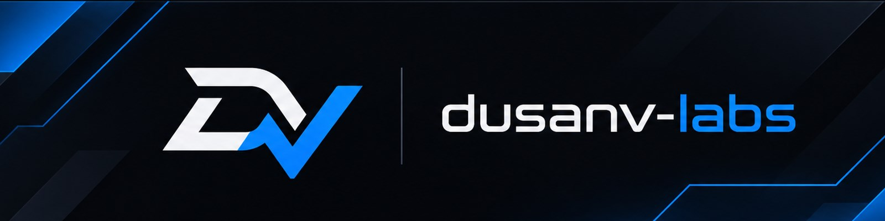

  

# Hi, I'm Dušan 👋

**Full Stack Developer** from Požarevac, Serbia, with 4+ years of experience building **SaaS web applications, admin portals and REST APIs**.

- 🛠️ Currently developing features for a **fleet operations and driver scheduling** platform, working directly with the client from requirements to delivery
- 🎟️ Previously built a **passenger transport ticketing platform**: a multi-client admin portal used by 10+ companies, online ticket sales with payments, and REST APIs for mobile apps, self-service kiosks and a smart-city e-bike system
- 🤖 AI-assisted development (Claude Code) is a core part of my daily workflow
- 🌍 Serbian (native) · English (professional working proficiency)

  
  
  

## 🚀 Featured project

### [BookTheCourt](https://github.com/dusanv-labs/book-the-court): sports court booking system

A full-stack booking app for padel, tennis and football courts, in English and Serbian:

- **Players:** availability calendar (fully booked days in red), hour grid with free courts and prices, booking code, cancel link and *Add to calendar*
- **AI booking assistant:** ask in plain language (*"Is there a free padel court tomorrow after 18:00?"*); a Claude tool-use agent with read-only tools finds free courts and shows checked options that open the booking form, with daily cost limits and no access to customer data
- **Venue admin:** bookings with search, phone bookings, courts, opening hours and prices, blocked time, and a **revenue report** with chart, print, XLSX and PDF export
- **Engineering:** double booking prevented by a PostgreSQL exclusion constraint, time zone and DST handled correctly, unit and end-to-end tests in CI, JWT auth, rate limiting

**[Live demo](https://dusanv-labs.github.io/book-the-court/)** · **[Source code](https://github.com/dusanv-labs/book-the-court)** · **[API docs](https://book-the-court-api.onrender.com/api/docs)**

## 🧰 Tech stack

**Languages**

**Backend**

**Frontend**

**Databases & tools**

---

🇷🇸 Portfolio and CV are also available in Serbian at <a href="https://dusanv-labs.github.io/?lang=sr">dusanv-labs.github.io</a>.
